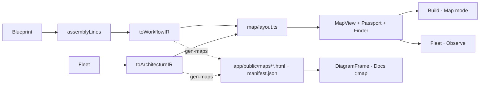

# Plan: The archify console

> Companion to `spec.md`.

## 1. Architecture Overview

One new leaf module tree, `app/src/map/`, is a *third* pure consumer of GitFactory's data model beside the compiler and the IR compiler: `layout.ts` turns archify IR JSON (from `app/src/archify/ir.ts`, unchanged) into positioned geometry using archify's own constants, and `MapView.tsx` draws that geometry as inline SVG with the seven `--c-*` tokens, the same classes the delivered maps use (`c-frontend` … `c-external`, `c-lane`, `c-security-group`, `c-mask`). The reader model — Finder, Passport with authored reachability, guided views, zoom, beacons — lives in `MapView` + `Passport.tsx` + `Finder.tsx` and is host-agnostic: a surface supplies the IR, optional beacons, and a `describe(nodeId)` that returns passport sections. Three hosts use it: the Build tab's Map mode (workflow IR per assembly line), Fleet Observe (architecture IR of the observed fleet, replacing the React Flow fleet canvas), and — for the delivered HTML itself — `DiagramFrame` embeds resolved through the `gen-maps` manifest. The shell grammar is a thin primitives layer (`app/src/ui/`) plus theme rules; the Build tab's palette and Inspector are re-homed as floating finder/passport panels over the canvas so the canvas is dominant per archify's `DESIGN.md`. See [docs/ARCHITECTURE.md](../../docs/ARCHITECTURE.md) § 7e (maps) and the new § 7f this spec adds (the console surfaces).

## 2. Component Changes

| Layer | File / Module | Change |
|-------|---------------|--------|
| Map (pure) | `app/src/map/layout.ts` (+ `layout.test.ts`) | `layoutWorkflow` / `layoutArchitecture` → `MapGeometry`; archify constants; orthogonal routes; reachability helpers (`upstream`/`downstream`) |
| Map (view) | `app/src/map/MapView.tsx`, `Passport.tsx`, `Finder.tsx`, `map.css` (+ `MapView.test.tsx`) | inline-SVG renderer, legend, beacons, focus/passport, `/` finder, views, zoom nav, keyboard |
| Map (delivered) | `app/src/map/manifest.ts` (+ test), `DiagramFrame.tsx` | `deliveredMapFor`, base-URL + theme-parity iframe |
| Maps script | `app/scripts/gen-maps.ts` | write `manifest.json`; `--check` covers it (already globs `*.json`) |
| Archify IR | `app/src/archify/ir.ts` | export `fleetComponentId` (same computation, same output) |
| Shell | `app/src/ui/primitives.tsx`, `ui.css` | `PageHeader`, `Panel`, `Cards`/`Card`, `Chip`, `Kbd`, `Eyebrow`, `SearchField`, `Beacon` |
| Shell | `app/src/App.tsx`, `theme.css` | toolbar-row top bar, theme toggle + `T`, `.btn` recipe, tabs as chips, workspace as floating-panel container |
| Build | `BuildToolbar.tsx`, `Palette.tsx` → `MachineFinder`, `Inspector.tsx` → passport body, `FactoryCanvas.tsx`, new `panels/LineMaps.tsx`, `state/ui.ts` (`buildMode`, `finderOpen`, `blueprintPassport`) | Floor/Map toggle, floating finder + passport, Map mode per line, machine passport with capabilities + Edit on the floor |
| Fleet | `canvas/FleetView.tsx`, delete `FleetCanvas.tsx` / `WorkflowNode.tsx` / `fleet/layout.ts` / `fleetview.css` | Observe → `MapView` over `toArchitectureIR(fleet, {cap})`, beacons from `statusByPath`, workflow passport, delivered-map link |
| Docs | `docs/markdown.ts` (+ test), `panels/DocsView.tsx`, `docs.css`, `_docs/*.md` | `::map` block → `DiagramFrame`; header grammar; embeds |
| Tabs | `MonitorPanel`, `ContentPanel`, `PromptStudio`, `SettingsPanel`, `FleetOpsPanel` + their css | `PageHeader` + `Panel` wrapping; alias retirement in touched rules |
| Demo | `demo/tour.ts` | Build/Fleet step copy |
| Docs (repo) | `docs/ARCHITECTURE.md` § 7f, `docs/ROADMAP.md`, `docs/GENERATED-FILES.md`, `docs/DECISIONS.md` (ADR-035), `README.md`, `CLAUDE.md` | the console surfaces, the manifest, current state |

## 3. Blueprint & Schema Changes

None.

## 4. Tech Choices & Alternatives

| Decision | Chosen | Alternatives Considered | Why |
|----------|--------|-------------------------|-----|
| How maps get into the app | A GitFactory-owned React/SVG view of the IR (`MapView`) for live surfaces; the delivered HTML embedded by iframe only where a committed map exists | (a) iframe the delivered HTML everywhere (rejected: only dogfood + demo sources have delivered maps, so live blueprints and observed repos would have no map); (b) run archify's renderer in the browser (rejected: ADR-034 D-1 — module-scope `process.argv` + `node:fs`, a fork) | Live coverage for every blueprint and fleet, one IR, one coordinate frame; the delivered map stays canonical (NG1) |
| Layout | Reuse archify's constants (lanes, columns, node size, grid) rather than a graph-layout algorithm | dagre/elk (rejected: new dependency, and the IR is already placed) | The IR is pre-laid-out by design; matching constants keeps the two views congruent |
| Palette / Inspector | Floating finder + passport over the canvas | Keep the three-column editor and add a fourth Map column (rejected: `DESIGN.md`'s stated anti-pattern) | Canvas dominance and progressive disclosure are the design language, not a preference |
| Manifest delivery | Build-time JSON import of `public/maps/manifest.json` | Runtime `fetch` (rejected: a request the demo's "zero network" claim would have to explain, and jsdom tests would need a shim) | Static, testable, zero requests |
| Theme toggle | Three-state cycle (system → dark → light) with `T` | Two-state like the viewer (rejected: would drop the `system` preference specs/011 added) | Keeps the existing preference model and the viewer's key |

ADR-035 (appended by this spec's session log) records the decision that the in-app map is a view of the IR, not a second renderer of the graph, and the retirement of the React Flow fleet canvas.

## 5. Least Privilege & Permissions

No compiled workflow, grant, or `permissions:` block is touched. The app gains no new write path; the delivered-map iframe and the manifest are read-only static assets produced by the build.

## 6. Loop Guards & Untrusted Input

No event-triggered code changes. Untrusted text (fleet workflow names, trigger details, blueprint config values, doc prose) is rendered exclusively through React text nodes in SVG/HTML; the `::map` directive resolves a slug only against the committed manifest, never a URL; the theme preference stays a validated enum.

## 7. Test Strategy

- `map/layout.test.ts` (node): determinism, bounds, no same-lane overlap, edge references, main-path roles, archify frame width, reachability helpers — over the dogfood lines and the three demo fleets (AC-1).
- `map/MapView.test.tsx` (jsdom): node groups + classes + labels, legend, finder (`/`, filter, Enter), passport (label/id, Escape), beacons text, views chips (AC-2).
- `map/manifest.test.ts` (node): `deliveredMapFor` resolves demo/dogfood sources and misses unknown ones; `DiagramFrame` `src` in both themes (AC-5 half).
- `docs/markdown.test.ts` (node): `::map` parses to a block with slug + caption; malformed stays a paragraph.
- `panels/LineMaps.test.tsx` / Build tests (jsdom): Map mode renders per line; Edit on the floor selects + switches; finder adds; Escape deselects (AC-3).
- `canvas/FleetView.test.tsx` (jsdom): demo observe → one node per workflow, beacons, passport, delivered link (AC-4).
- Existing suites stay green; `theme.test.ts` guards literals (AC-7). Browser pass per AC-8 with screenshots.

## 8. Rollout

Pages picks it up on merge; no kill switch (pure UI). `npm run maps` regenerates the manifest once; `maps:check` in CI keeps it exact.

## 9. Risks & Mitigations

| Risk | Likelihood | Impact | Mitigation |
|------|------------|--------|------------|
| In-app map and delivered map diverge visually | med | low | Same IR, archify's constants asserted, delivered map linked from each surface |
| Floating panels overlap on narrow screens | med | low | Finder left / passport right, `min()` widths, scroll inside; narrow screens get containment (DESIGN.md) |
| Bundle growth | low | low | No dependency; measured against NFR-STATIC-1 in the PR |
| Removing FleetCanvas breaks a hidden consumer | low | med | grep for imports before deletion; typecheck + tests |

## 10. Estimated Effort

One session, eight tasks.
