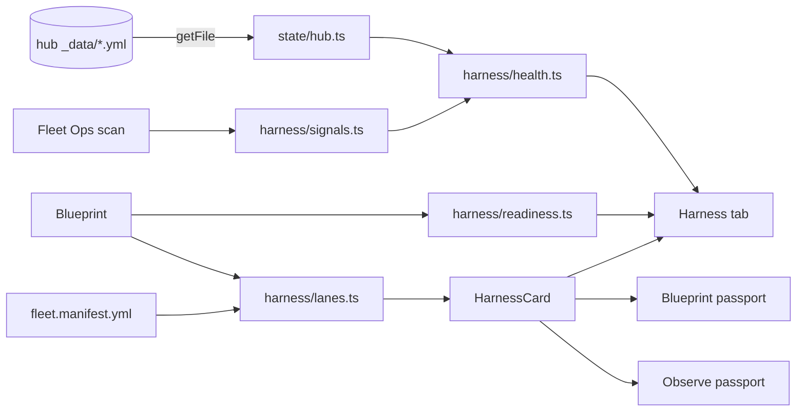

# Plan: Harness parity

> Companion to `spec.md`.

## 1. Architecture Overview

One new pure module tree, `app/src/harness/`, holds the hub's harness model in TypeScript: `health.ts` is a line-for-line port of `dash-gen harness` (the scorecard and the six trip wires, the hub's thresholds as defaults, the hub's output shape), `signals.ts` maps Fleet Ops' live scan results into the hub's four signal shapes so the same engine runs over a live fleet, `lanes.ts` compiles assembly lines to `fleet/v1` lanes and parses any repo's `fleet.manifest.yml`, and `readiness.ts` audits a blueprint's lines against the six layers and the hub's twelve-row production-readiness checklist. A small store, `state/hub.ts`, reads the hub's committed `_data/*.yml` through the existing `GithubClient` seam on demand (the demo client serves a fixture hub, so the tab lives on Pages), and the Harness tab renders the hub page's anatomy over either source. The `fleet/v1` lane is the interchange contract: the same `HarnessCard` renders a lane on the floor (Blueprint passport), in Fleet Observe (workflow passport), and in the Harness tab. See [docs/ARCHITECTURE.md](../../docs/ARCHITECTURE.md) § 7g.

## 2. Component Changes

| Layer | File / Module | Change |
|-------|---------------|--------|
| Harness (pure) | `app/src/harness/health.ts` (+ `health.test.ts`, `fixtures/hub/*`) | signal types, config defaults, `parseHarnessConfig`, `buildScorecard`, `evaluateTripWires`, `harnessHealth`; golden + invariant tests |
| Harness (pure) | `app/src/harness/signals.ts` (+ test) | Fleet Ops snapshots → `ActionsUsage` + `FleetTriage` |
| Harness (pure) | `app/src/harness/lanes.ts` (+ test) | `toFleetLanes`, `parseFleetManifest`, the kind table; parity against `fleet.manifest.yml` |
| Harness (pure) | `app/src/harness/readiness.ts` (+ test) | six layers per line + the checklist |
| Harness (view) | `app/src/harness/HarnessCard.tsx` | one lane card |
| State | `app/src/state/hub.ts` (+ test) | persisted `hubSlug`, `refresh()`, committed + recomputed health, parity note |
| Panel | `app/src/panels/HarnessPanel.tsx`, `harness.css` (+ test) | the hub page anatomy, source switch, illustrated embeds, readiness, lanes |
| Shell | `App.tsx`, `state/ui.ts`, `SettingsPanel.tsx`, `demo/tour.ts` | tab, lazy chunk, `?hub=`/`?tab=`, hub field, tour step |
| Fleet | `fleet/import.ts`, `fleet/types.ts`, `canvas/ObserveMap.tsx` | fetch the manifest with the fleet; `lane` on `ImportedWorkflow`; card in the passport |
| Floor | `panels/Inspector.tsx` | Blueprint passport → Lanes section |
| Demo | `demo/fixtures.ts`, `demo/client.ts` | `acme/hub` fixture files (`_data/*.yml`, `fleet.manifest.yml`) |
| Docs | `docs/ARCHITECTURE.md` § 7g, `docs/ROADMAP.md`, `docs/DECISIONS.md` (ADR-036), `README.md`, `CLAUDE.md`, `_docs/the-harness.md` | the harness model and the hub contract |

## 3. Blueprint & Schema Changes

None.

## 4. Tech Choices & Alternatives

| Decision | Chosen | Alternatives Considered | Why |
|----------|--------|-------------------------|-----|
| Health computation | A pure TS port of `harness.py`, proven by a golden test over the hub's committed inputs and output | Read only the hub's committed `harness_health.yml` (rejected: no live mode and no parity proof); call the hub's Python (rejected: golden rule #1) | One engine, two sources, and a test that fails the day the hub's rules move |
| Interchange contract | `fleet/v1` lanes (`fleet.manifest.yml`) | A GitFactory-specific inventory (rejected: the hub and `wtd` already speak `fleet/v1`; gitorio's own manifest exists) | The vocabulary both sides already commit |
| Hub reads | On-demand `getFile` per signal through `GithubClient` | Fetch the Pages site's HTML (rejected: unstructured, no ETag, a second transport) | Same seam, same demo substitution, no polling |
| Diagrams | Embed the hub's delivered diagrams from its Pages URL; GitFactory's own delivered maps in the demo | Re-render the hub's IR in-app (dataflow/lifecycle/sequence layouts not built yet — BL-20260828-04) | Same picture the hub shows, zero duplication |
| Visual parity | Same anatomy and vocabulary in the Evidence Console tokens | Adopt Bootstrap/the air skin (rejected: contradicts specs/011 and 013, which the operator asked for) | The operator asked for both; content parity is what makes "render the same" true |

ADR-036 records the parity decision (one engine, the hub's rules; `fleet/v1` as the contract) and the reconciliation of specs/012's fleet-source premise.

## 5. Least Privilege & Permissions

No compiled workflow, grant, or `permissions:` block is touched. Hub reads use the connected token's existing read scope; nothing is written anywhere.

## 6. Loop Guards & Untrusted Input

No event-triggered code. Hub and manifest YAML are untrusted data: parsed tolerantly, numbers coerced and bounded, strings rendered as text nodes; the slug is validated (`owner/name`) before a Pages URL is built; nothing parsed reaches a prompt, a grant, or the compiler.

## 7. Test Strategy

- `health.test.ts`: golden parity over `fixtures/hub/` (AC-1); the twelve ported invariants (AC-2).
- `signals.test.ts`: demo scan → signals → health (AC-3).
- `lanes.test.ts`: gitorio blueprints → lanes vs the committed manifest (AC-5); `parseFleetManifest` tolerance.
- `readiness.test.ts`: dogfood blueprint layers and checklist (AC-6).
- `hub.test.ts` (jsdom): demo hub refresh → committed health + recomputed health + parity note; missing files degrade.
- `HarnessPanel.test.tsx` (jsdom): the anatomy over the demo hub (AC-4).
- Browser pass per AC-7.

## 8. Rollout

Pages picks it up on merge; no kill switch (read-only UI). The hub slug defaults to `bamr87/bamr87`; a visitor without a token sees the demo hub.

## 9. Risks & Mitigations

| Risk | Likelihood | Impact | Mitigation |
|------|------------|--------|------------|
| Hub generator drift | med | med | Golden fixtures pinned to a commit; parity note in production; re-fixture follow-up |
| Lane kind mismatches on other repos | med | low | Explicit table, tested on gitorio's manifest; display-only |
| Hub file sizes (`actions_usage.yml` ~6k lines) | low | low | Parsed once per refresh on demand; only totals + workflows kept in state |

## 10. Estimated Effort

One session, eight tasks.
